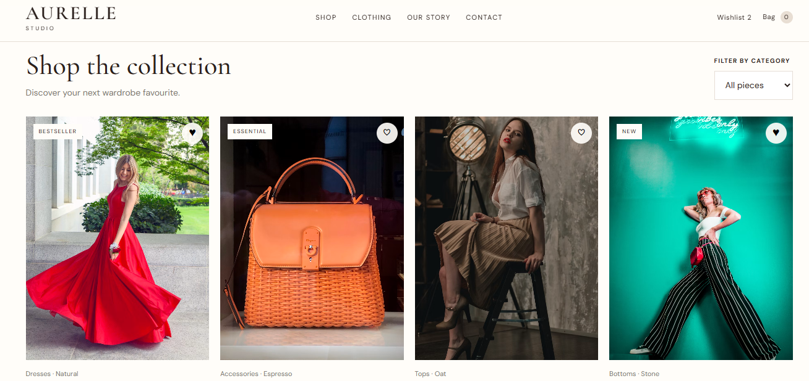
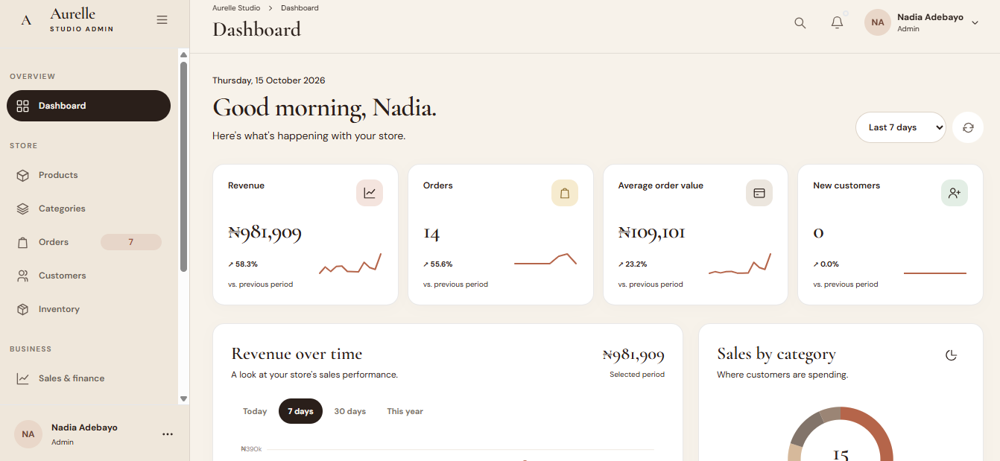

# Aurelle Studio

### Modern Fashion. Timeless Elegance.

Aurelle Studio is a fashion e-commerce web application designed to deliver an elegant online shopping experience alongside a dedicated administration interface for managing store operations.

Built around a refined visual identity, responsive layouts, and a customer-focused shopping journey, the project brings together a fashion storefront and an admin dashboard in one cohesive platform.


## Project Preview

<p align="center">
  
  
</p>


---

## Overview

Aurelle Studio aims to simplify online fashion retail through a clean storefront experience and a centralised store management interface.

The project is organised around two primary experiences:

- **Customer Storefront** — Discover collections, browse products, explore product details, manage a wishlist, and interact with the shopping cart.
- **Admin Dashboard** — Access store management interfaces for products, categories, orders, customers, inventory, sales, reviews, staff, and settings.

The application is designed with a responsive, boutique-inspired interface that prioritises usability, visual consistency, and ease of navigation.

## Features

### Customer Storefront

- Elegant landing page with featured products and collections
- Product catalogue and product detail pages
- Product categories and collection navigation
- Shopping cart and wishlist interfaces
- Checkout and order confirmation pages
- Order tracking interface
- About, contact, FAQ, and store policy pages
- Responsive layouts for desktop, tablet, and mobile devices

### Administration

- Admin login interface
- Dashboard and store overview
- Product and category management interfaces
- Order management
- Customer and staff management
- Inventory and stock movement interfaces
- Sales and reporting interfaces
- Product reviews and notification interfaces
- Store settings and profile pages
- Role-based navigation and access-control interfaces

*Feature availability depends on the current implementation. Backend-dependent functionality, secure authentication, persistent order processing, and payment processing may require additional integration.*

## Design Philosophy

Aurelle Studio uses a modern boutique aesthetic inspired by understated luxury and contemporary fashion retail.

Design priorities include:

- **Minimalism:** Clean layouts that keep attention on products.
- **Visual consistency:** A coordinated palette, typography, spacing, and reusable interface patterns.
- **Responsive design:** Interfaces designed to adapt to different screen sizes.
- **Usability:** Clear navigation, meaningful feedback, and straightforward shopping flows.
- **Maintainability:** A structured codebase that separates shared utilities from page-specific functionality.

## Technology Stack

The project is built primarily with web technologies:

- **HTML5** — Page structure and semantic markup
- **CSS3** — Layout, styling, and responsive design
- **JavaScript** — Client-side interactions and application logic
- **Local Storage** — Prototype persistence for supported browser-side data
- **Git and GitHub** — Version control and source-code hosting

The current project structure is designed to support a multi-page application without requiring a frontend framework.

## Project Structure

```text
aurelle-studio/
├── index.html
├── login.html
├── dashboard.html
├── shop.html
├── product-details.html
├── cart.html
├── checkout.html
├── order-success.html
├── track-order.html
├── wishlist.html
├── products.html
├── product-form.html
├── categories.html
├── orders.html
├── customers.html
├── users.html
├── inventory.html
├── sales.html
├── reviews.html
├── settings.html
├── profile.html
├── notifications.html
├── about.html
├── contact.html
├── faq.html
├── privacy.html
├── terms.html
├── shipping-returns.html
└── assets/
    ├── styles.css
    ├── storefront.css
    ├── store.js
    ├── auth.js
    ├── ui.js
    ├── layout.js
    ├── charts.js
    ├── data.js
    ├── tailwind-config.js
    └── pages/
```

*This is a representative overview. The exact files and directories may differ as development progresses.*

## Getting Started

### Prerequisites

You will need:

- A modern web browser
- Git
- A code editor such as Visual Studio Code

No package installation is required for pages that use only static HTML, CSS, and JavaScript.

### Installation

**1. Clone the repository**

Replace `YOUR-USERNAME` with your GitHub username.

```bash
git clone https://github.com/YOUR-USERNAME/aurelle-studio.git
```

**2. Navigate to the project directory**

```bash
cd aurelle-studio
```

**3. Open the project**

You can open `index.html` directly in your browser, or use the Live Server extension in Visual Studio Code for a local development server.

For the best development experience, open the entire project folder in VS Code and launch `index.html` with Live Server.

### Accessing the Admin Interface

Open `login.html` in your browser to access the administration login page.

If demo credentials are configured in your current version, use the credentials documented in the application's development setup. Do not use demo credentials for a production deployment.

## Configuration and Data

The current prototype uses browser-side JavaScript and may use `localStorage` to persist application data.

This approach is useful for demonstrations and local development, but it has limitations:

- Data is stored in the browser rather than a central database.
- Data does not automatically synchronise across different users or devices.
- Clearing browser storage may remove locally persisted data.
- Client-side access checks are not a substitute for server-side authorisation.
- Local storage is not suitable for secrets, payment credentials, or sensitive customer information.

A production implementation should connect the storefront and admin dashboard to a shared backend, database, and secure authentication system.

## Development Roadmap

Planned improvements may include:

- [ ] Unify product and category data between the storefront and admin dashboard
- [ ] Complete and test the end-to-end shopping cart and checkout flow
- [ ] Integrate a backend API and persistent database
- [ ] Implement secure authentication and server-side role-based authorisation
- [ ] Integrate a payment provider
- [ ] Add reliable order creation, fulfilment, and tracking
- [ ] Add product image upload and media management
- [ ] Implement server-side validation and error handling
- [ ] Add automated tests for critical shopping and administration flows
- [ ] Optimise performance, accessibility, and search engine visibility
- [ ] Deploy the application to a production hosting environment

## Deployment

The storefront can be deployed to a static hosting provider if all required pages and assets are self-contained.

Possible hosting options include:

- [GitHub Pages](https://pages.github.com/)
- [Netlify](https://www.netlify.com/)
- [Vercel](https://vercel.com/)

**Important:** A static deployment does not provide a secure backend, shared database, or payment processing by itself. Any production deployment of the full platform will need infrastructure appropriate to its backend and security requirements.

## Contributing

Contributions, bug reports, and suggestions are welcome.

To propose a change:

1. Fork the repository.
2. Create a feature branch.
3. Make your changes and test the affected pages.
4. Commit your work with a descriptive message.
5. Open a pull request describing the changes.

For example:

```bash
git checkout -b feature/your-feature
git add .
git commit -m "Add your feature"
git push origin feature/your-feature
```

## Security

Please do not commit API keys, passwords, private environment files, payment credentials, or real customer data to the repository.

Before production release, ensure that authentication, authorisation, input validation, payment processing, and customer data storage are handled securely.

If you discover a security issue, avoid publishing sensitive exploit details in a public issue.

## License

No license has been specified yet.

Before distributing or allowing reuse of this project, add a `LICENSE` file with the terms you intend to use. Without an applicable license, the default copyright restrictions generally apply.

## Acknowledgements

Aurelle Studio is developed as a modern fashion retail web application, with an emphasis on elegant design, intuitive shopping, and streamlined store management.

---

**Aurelle Studio** — *Style, thoughtfully curated.*
